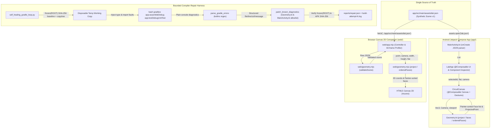

# Architecture and Source Map

## System Overview

`spatial-electronics-lab` is a cross-platform synthetic 2D/3D electronics circuit layout inspector and bounded compiler-repair benchmark built around a single declarative scene contract (`app/src/main/assets/lab.json`):

1. **Android Jetpack Compose Inspector (`app/src/main/java/id/autonomous/spatialmap/`)**: Kotlin + Material 3 application (`MainActivity.kt`, `Geometry.kt`) rendering orthographic 2D and perspective-projected Painter's-sorted 3D component blocks, pins, and board interconnects with multi-touch orbit/zoom and tap hit-testing.
2. **Zero-Dependency Browser Companion (`web/`)**: ES module + HTML5 Canvas 2D inspector (`web/index.html`, `web/app.mjs`, `web/geometry.mjs`) consuming the exact same `lab.json` asset, enforcing strict schema invariants (`validateScene`), and providing a 60-frame synchronous draw-cost profiler.
3. **Bounded Gradle Self-Healing Loop (`self_healing_gradle_loop.py`)**: Deterministic Python harness that clones the repository into an isolated working copy, injects two known Kotlin/Compose compilation faults, runs real Gradle builds (`:app:assembleDebug :app:testDebugUnitTest`), parses `kotlinc` diagnostics, applies allowlisted repairs, and verifies SHA-256 immutability of the source tree and non-target files.

## System Context & Data Flow



## Execution & Pipeline Sequences

```mermaid
sequenceDiagram
  autonumber
  actor User as User / CI Runner
  participant WebApp as web/app.mjs
  participant Geom as Geometry Engine (web/geometry.mjs & Geometry.kt)
  participant Repair as self_healing_gradle_loop.py
  participant Gradle as Gradle (:app:assembleDebug + UnitTest)

  Note over User,Geom: Flow A — Cross-Platform 2D/3D Projection & Painter's Sort Pipeline
  User->>WebApp: Load page / Orbit drag / Toggle 2D-3D / Click component pin
  WebApp->>Geom: validateScene(lab.json) -> verify schema_version=1, bounds <= 220, links
  WebApp->>Geom: orderedFaces(components, camera, width, height)
  Geom->>Geom: Rotate (x, y) by yaw, compute depth = distance + ry*cos(pitch) - z*sin(pitch)
  Geom->>Geom: Cull vertices with depth <= 10; project 8 box corners & 5 visible quads
  Geom-->>WebApp: Quads sorted descending by mean vertex depth (back-to-front)
  WebApp-->>User: Render grid -> links -> sorted 3D faces (or 2D rects) -> pin markers & inspector

  Note over User,Gradle: Flow B — Bounded Self-Healing Gradle Repair Loop (Linux / WSL)
  User->>Repair: python self_healing_gradle_loop.py --attempts 3 --timeout 300
  Repair->>Repair: Record frozen(ROOT) SHA-256 map, copytree to /tmp, inject 2 known Kotlin faults
  loop Attempt 1 .. N (bounded 2..5)
    Repair->>Gradle: Run :app:assembleDebug :app:testDebugUnitTest (--no-daemon)
    Gradle-->>Repair: Exit code + plain compiler output
    Repair->>Repair: Assert frozen(ROOT) == baseline & modified files subset of {Geometry.kt, MainActivity.kt}
    alt Build failed (code != 0)
      Repair->>Repair: parse_gradle_errors() -> patch_known_diagnostics()
    else Build succeeded on attempt >= 2
      Repair->>Repair: Verify app-debug.apk exists, hash APK, write reports/repair.json (status='pass')
    end
  end
```

## Module Breakdown

### 1. Shared Scene Specification (`app/src/main/assets/lab.json`)
- Defines `schema_version: 1`, `data: "synthetic"`, board metadata, and 4 illustrative electronics blocks (`mcu`, `imu`, `temperature`, `uart`) with planar coordinates `(x, y)` in `[-220, 220]`, positive dimensions `(width, depth, height <= 150)`, 6-digit hex `color`, `pins`, and undirected `links`.

### 2. Android Application (`app/src/main/java/id/autonomous/spatialmap/`)
- `Geometry.kt`: Immutable Kotlin data classes (`Vec3`, `ProjectedPoint`, `Camera`, `LabComponent`, `Face`) and pure projection math (`radians`, `project`, `faces`, `orderedFaces`). Enforces finite inputs, positive viewport/camera distance, near-plane clipping (`depth <= 10f`), orthographic 2D scaling (`min(w, h) / 430f`), perspective 3D scaling (`min(w, h) * 1.7f / depth`), and back-to-front Painter's sorting.
- `MainActivity.kt`: Parses `lab.json` in `onCreate` and mounts Material 3 `LabApp` + `CircuitCanvas`. Supports 2D/3D `FilterChip` switching, `detectTransformGestures` orbit/zoom (`elevation` clamped to `[20f, 75f]`, `distance` clamped to `[550f, 1100f]`), `detectTapGestures` pin selection within a `40px` radius, button-based selection/yaw controls, and screen-reader semantics.
- `app/src/test/java/id/autonomous/spatialmap/GeometryTest.kt`: JUnit 4 unit suite testing center projection, finite bounds across extreme angles, depth ordering, near-plane culling, and invalid viewport `IllegalArgumentException` guards.

### 3. Web Companion (`web/`)
- `web/geometry.mjs`: Pure ES module mirroring `Geometry.kt` projection and Painter's sort math while adding `validateScene(scene)` for strict schema, duplicate-ID, bounding-box, hex-color, and non-self-referential link validation.
- `web/app.mjs` & `web/index.html` & `web/style.css`: Responsive browser UI fetching `../app/src/main/assets/lab.json`, rendering on DPR-scaled `<canvas id="scene">`, supporting pointer orbit, tap hit-testing (`< 32px`), wheel zoom, keyboard navigation (`Arrow*`, `+`, `-`), and a 60-frame synchronous Canvas timing sweep (`#measure`).

### 4. Compiler-Repair Harness & Verification (`self_healing_gradle_loop.py`, `tests/`)
- `self_healing_gradle_loop.py`: Rejects symlinks, isolates builds in `tempfile.mkdtemp`, injects and repairs two deterministic diagnostics (`Math.toRadians(...).toFloat()` return-type mismatch in `Geometry.kt` and missing `detectTransformGestures` import in `MainActivity.kt`), enforces process-group timeouts (`os.killpg`), and writes sanitized logs + `reports/repair.json`.
- `tests/geometry.test.mjs` & `tests/test_repair.py`: Node and Python test suites executed in CI (`.github/workflows/verify.yml`) alongside Gradle unit/APK tasks.

## State Management

- **Jetpack Compose (`MainActivity.kt`)**:
  - `selectedId` (`String`, default `"mcu"`) and `flat` (`Boolean`, default `false`) use `rememberSaveable` to survive Android configuration changes (rotation, window resize).
  - `camera` (`Camera(yaw=30f, elevation=55f, distance=720f)`) uses `remember { mutableStateOf(...) }`, while `CircuitCanvas` captures `rememberUpdatedState(camera)` so long-lived `pointerInput(flat)` gesture coroutines always read the latest camera state without restarting gestures mid-drag.
- **Browser Companion (`web/app.mjs`)**:
  - Holds single-module state (`scene`, `camera`, `flat`, `selected`, `drag`, `width`, `height`) mutated exclusively through event handlers (`inspect`, `mode`, pointer/wheel/key listeners) that synchronously trigger `draw()` and sync `aria-pressed` DOM attributes.
- **Self-Healing Gradle Loop (`self_healing_gradle_loop.py`)**:
  - Stateless functional transforms backed by cryptographic tree snapshots (`frozen(ROOT)` and `frozen(work)`). Asserts zero mutation of `ROOT` and restricts working-copy file diffs strictly to `{Geometry.kt, MainActivity.kt}` after every Gradle invocation.

## Local Verification & Test Commands

Run the cross-platform Node and Python verification suites on Windows/macOS/Linux from `C:\Users\ardhy\Projects\spatial-electronics-lab`:

```powershell
node --test tests/*.test.mjs
C:\Python314\python.exe -m pytest -q
C:\Python314\python.exe -m unittest discover -s tests -v
```

On Linux or WSL with Android SDK/JDK configured (as in `.github/workflows/verify.yml`):

```bash
./gradlew testDebugUnitTest assembleDebug --no-daemon
python3 self_healing_gradle_loop.py --report reports/ci-repair.json
```
