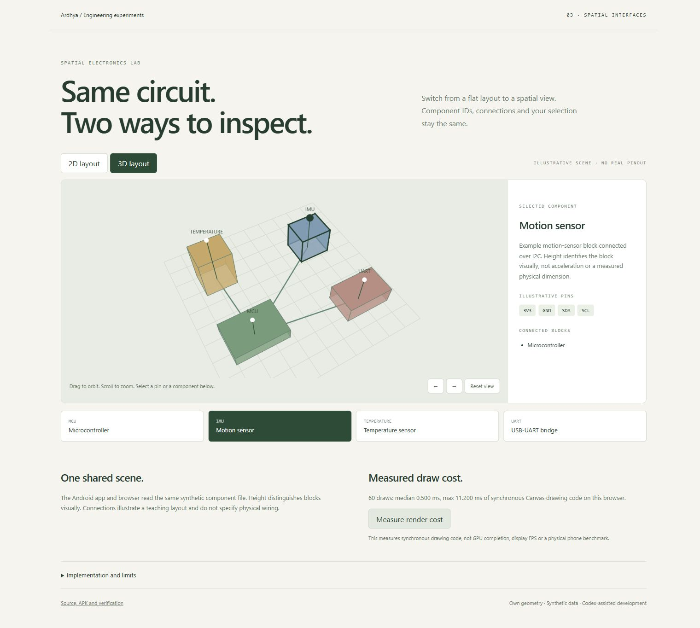

# Spatial Electronics Lab

[](https://github.com/vanovri/spatial-electronics-lab/actions/workflows/verify.yml)

A Kotlin/Jetpack Compose Android app and browser companion for inspecting the same
synthetic electronics layout in 2D and perspective 3D. Selecting a component keeps
its ID, illustrative pins, links, and details consistent when changing modes.



## Android

JDK 17, Android SDK Platform 35, Build Tools 35.0.0. Gradle 8.9, AGP 8.7.3,
Kotlin/Compose compiler 2.0.21, and Compose BOM 2024.12.01 are pinned.

```sh
bash gradlew :app:assembleDebug :app:testDebugUnitTest --console=plain --no-daemon
```

The actual debug APK is produced at `app/build/outputs/apk/debug/app-debug.apk`.
Releases include a build for development/testing. It is not a Play Store release.
Open the project in Android Studio or build through WSL with `ANDROID_HOME` set
to an installed SDK. The Gradle wrapper also includes the normal Windows launcher.

The app supports 2D/3D switching, component buttons, pin selection, orbit gestures,
pinch zoom, and camera reset. Numerical tests run on the JVM. The browser companion
has separate desktop/mobile/keyboard checks. Browser screenshots do not establish
an Android emulator or physical-device runtime test.

## Browser companion

```sh
python -m http.server 8767 --bind 127.0.0.1
# Open http://127.0.0.1:8767/web/
node --test tests/geometry.test.mjs
```

No external scripts or assets are fetched. Serve the repository root, because both
implementations read `app/src/main/assets/lab.json`. That file is the single scene
source. Component buttons provide keyboard selection; arrows and +/- on the canvas
adjust the camera. Drag or scroll for orbit/zoom.

The render-cost button records 60 synchronous Canvas draw spans in the current
browser. It measures drawing-code wall time, not GPU completion or display FPS.
The recorded browser QA includes viewport/Canvas dimensions and a narrow-layout
overflow check in [docs/web-qa.json](docs/web-qa.json).

## Real compiler-repair exercise

```sh
python3 -m unittest discover -s tests -v
python3 self_healing_gradle_loop.py --report reports/repair.json --attempts 3 --timeout 300
```

Run through Linux/WSL after the normal Android build. The harness copies the trusted
project, injects a Float/Double return mismatch and a missing gesture import, then
runs real `assembleDebug` and `testDebugUnitTest` commands. It parses actual Kotlin
diagnostics, applies only two known repairs inside two allowlisted source files,
and requires a real APK plus successful unit tests. It never substitutes simulated
compiler messages or a hardcoded success result.

Original source files are hashed and checked for preservation. All tests, build
configuration, scene data, and other copied source files are frozen for the repair
attempt. Attempt count and per-build timeout are enforced; a timeout kills the
build process group. The working copy and real logs are retained for review.

This bounded deterministic repair is not a general autonomous coding agent or a
security sandbox for untrusted Gradle code. Unknown errors stop the exercise.

## Verification and model limits

- Ten Kotlin geometry tests cover landmarks, angle conversion, near-plane rejection,
  camera envelopes, invalid/non-finite input, flat invariance, and global face order.
- Six Node tests cover shared scene validation and the browser geometry contract.
- Three Python tests cover diagnostic parsing, known repair idempotence, and scope.
- CI builds the APK, runs all three suites, then runs the actual compiler-repair loop.

The scene uses own box geometry and illustrative scene units. Pin names do not
specify an actual board pinout or wiring plan. Height distinguishes blocks visually.
Faces use global Painter ordering, not a depth buffer; this is a non-intersecting
teaching scene, not a CAD or geographic reconstruction. Pins remain visible as
selection markers. No GPS, sensor measurement, external model call, or device link
is involved.

## Provenance

Original synthetic layout and implementation developed with Codex assistance from
the user's Android spatial-migration brief and earlier Spatial Electronics Lab idea.
No Google/Gemini autonomous run, benchmark, or private thesis/firmware is claimed.
The supplied regex/auto-patch example was replaced with a path-scoped, idempotent
repair on a working copy and actual build evidence.

MIT licensed for the project implementation. Gradle's wrapper and downloaded
Android/Kotlin/AndroidX dependencies retain their own licenses. See
[THIRD_PARTY.md](THIRD_PARTY.md) and [bounded prompt](AGENT_GOAL_PROMPT.md).
